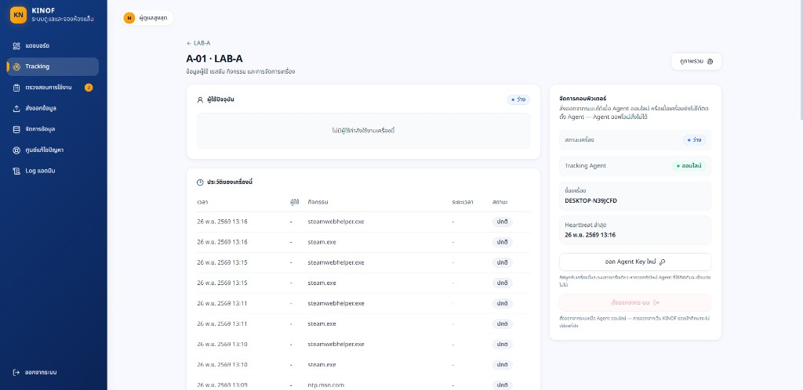
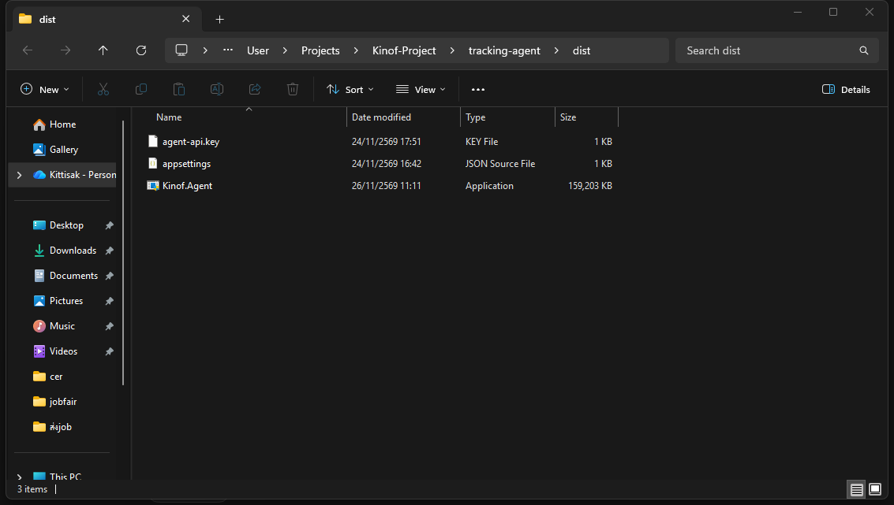
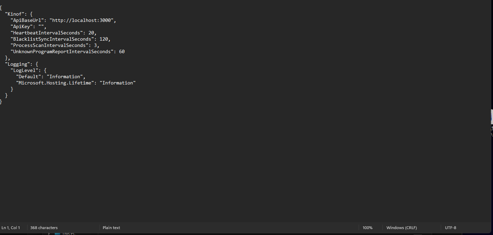
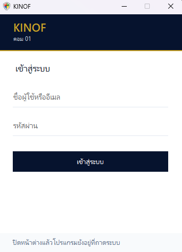
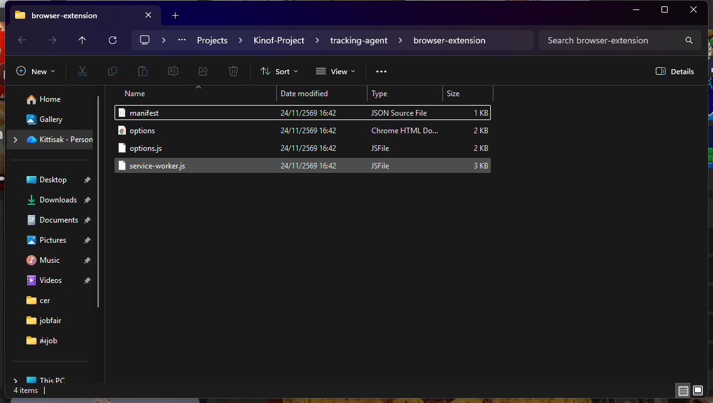
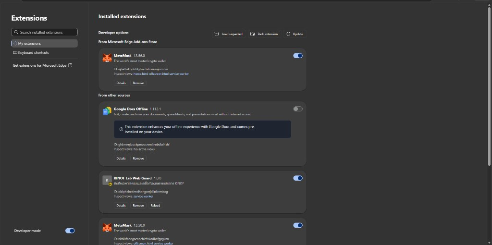
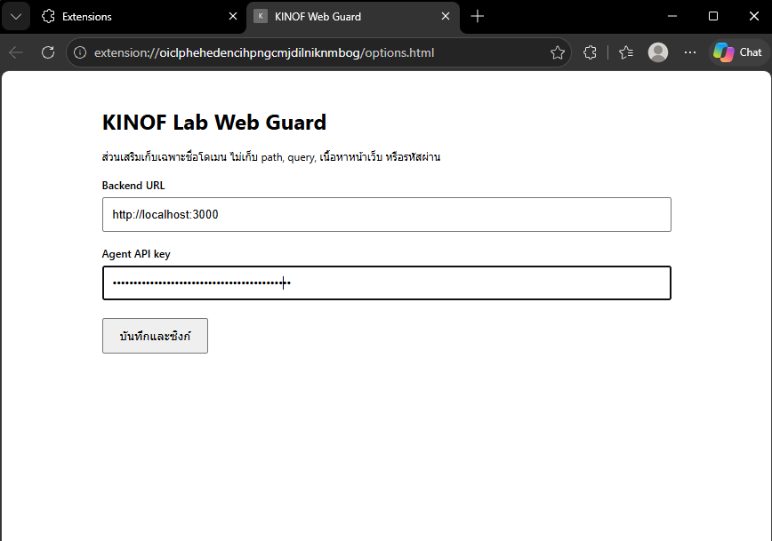

# คู่มือติดตั้ง KINOF Agent และส่วนขยายเบราว์เซอร์

ใช้กับเครื่องแล็บหนึ่งเครื่องต่อหนึ่งรหัส Agent ไฟล์รหัสอยู่ใน `agent-api.key` ห้ามส่งไฟล์นี้ขึ้น git และห้ามแปะรหัสลงในคู่มือ

## สิ่งที่ต้องมี

- Windows 10 หรือ 11
- เซิร์ฟเวอร์ KINOF เปิดอยู่ ถ้าลงเอเจนต์บนเครื่องเดียวกับเซิร์ฟเวอร์ ที่อยู่คือ `http://localhost:3000`
- รหัส Agent ของเครื่องนั้น ผู้ดูแลสร้างจากหน้า Tracking

ผู้ดูแลเข้าเมนู Tracking เลือกเครื่อง แล้วกด **ออก Agent Key ใหม่** ที่การ์ดด้านขวา ระบบแสดงรหัสครั้งเดียว ให้คัดลอกทั้งบรรทัดไปใส่ไฟล์ชื่อ `agent-api.key` ห้ามใส่เครื่องหมายคำพูดหรือเว้นวรรคเพิ่ม ถ้ากดออกใหม่ รหัสเก่าใช้ไม่ได้ และเอเจนต์ที่ใช้รหัสเก่าจะหลุดจนกว่าจะวางไฟล์รหัสใหม่



บนเครื่องที่ใช้พัฒนา ไฟล์ exe ที่พร้อมเปิดอยู่ที่ `tracking-agent/dist`

## 1. เปิดเอเจนต์

โฟลเดอร์ต้องมีอย่างน้อยสามไฟล์นี้อยู่ด้วยกัน

- `Kinof.Agent.exe`
- `appsettings.json`
- `agent-api.key`



ถ้าเครื่องแล็บไม่ใช่เครื่องที่รันเซิร์ฟเวอร์ ให้เปิด `appsettings.json` แล้วเปลี่ยน `ApiBaseUrl` เป็นที่อยู่เซิร์ฟเวอร์ ช่อง `ApiKey` เว้นว่างได้ เพราะโปรแกรมอ่านรหัสจากไฟล์ `agent-api.key` ที่อยู่ข้าง exe



วิธีเปิด

1. ดับเบิลคลิก `Kinof.Agent.exe` หรือไอคอน KINOF Agent บนเดสก์ท็อป
2. กด Yes เมื่อ Windows ถามสิทธิ์ผู้ดูแลระบบ ต้องใช้สิทธิ์นี้เพื่อปิดโปรแกรมที่ถูกบล็อกและเขียนไฟล์ hosts
3. หน้าต่างล็อกอินของ KINOF จะขึ้น ใส่ชื่อผู้ใช้และรหัสผ่านของบัญชีที่มีตารางเรียนหรือการจองในช่วงเวลานั้น



ปิดหน้าต่างแล้วยังทำงานอยู่ที่ไอคอนถาด มุมขวาล่าง ดับเบิลคลิกไอคอนเพื่อเปิดหน้าต่างกลับมา ถ้าจะปิดโปรแกรมจริง ใช้เมนูที่ไอคอนถาด

รันได้ทีละตัวบนเครื่องเดียวกัน อย่าเปิดพร้อมกับคำสั่ง `dotnet run` หรือสคริปต์ PowerShell ตัวเก่า

### ย้ายไปเครื่องแล็บเครื่องอื่น

1. คัดลอกทั้งโฟลเดอร์ `dist`
2. เปิด `appsettings.json` แล้วตั้ง `ApiBaseUrl` เป็นที่อยู่เซิร์ฟเวอร์ เช่น `http://192.168.1.10:3000` ถ้าเครื่องนั้นไม่ใช่เครื่องที่รันเซิร์ฟเวอร์
3. วาง `agent-api.key` ของเครื่องนั้นทับไฟล์เดิม หนึ่งเครื่องใช้หนึ่งรหัส
4. ดับเบิลคลิก `Kinof.Agent.exe`

ถ้าหน้าต่างขึ้นว่าให้วางไฟล์ `agent-api.key` แปลว่าไฟล์รหัสไม่อยู่ข้าง exe หรือไฟล์ว่าง

### สร้างไฟล์ exe ใหม่

ต้องมี .NET SDK 8 เปิด PowerShell ที่โฟลเดอร์ `tracking-agent/windows-app` แล้วรัน

```powershell
dotnet publish -c Release -o ..\dist
```

จากนั้นคัดลอก `agent-api.key` ไปไว้ในโฟลเดอร์ `dist` ข้าง exe ไฟล์ exe ไม่ต้องติดตั้ง .NET เพิ่มบนเครื่องแล็บ

## 2. ติดตั้งส่วนขยายเบราว์เซอร์

ส่วนขยายชื่อ KINOF Lab Web Guard อยู่ในโฟลเดอร์ `tracking-agent/browser-extension` ใช้กับ Microsoft Edge หรือ Google Chrome ตัวนี้เป็นตัวส่งรายการเว็บไซต์เข้าหน้าตรวจสอบการใช้งาน เอเจนต์อย่างเดียวไม่เก็บบันทึกที่อยู่เว็บ



1. เปิด `edge://extensions` หรือ `chrome://extensions`
2. เปิดโหมดนักพัฒนา มุมล่างซ้าย
3. เลือก Load unpacked แล้วเลือกโฟลเดอร์ `browser-extension` เมื่อติดตั้งแล้วจะเห็นการ์ด KINOF Lab Web Guard



4. เปิดรายละเอียดของ KINOF Lab Web Guard แล้วเปิดตัวเลือกส่วนขยาย
5. ช่อง Backend URL ใส่ที่อยู่เดียวกับ `ApiBaseUrl` ของเอเจนต์บนเครื่องนั้น
6. ช่อง Agent API key ใส่รหัสเดียวกับในไฟล์ `agent-api.key` ของเครื่องนั้น ช่องนี้แสดงเป็นจุด
7. กด บันทึกและซิงก์ ต้องขึ้นว่าบันทึกและซิงก์แล้ว



ถ้าไม่ใส่รหัส ช่องเว็บไซต์ในหน้าตรวจสอบการใช้งานจะว่าง ทั้งที่ส่วนขยายติดตั้งแล้ว

## 3. เข้าใช้งานเว็บ

ตอนนี้เว็บอยู่บนเครื่องนี้ ที่อยู่คือ `http://localhost:5173` เปิดจากเครื่องอื่นยังไม่ได้ เมื่อย้ายขึ้นเซิร์ฟเวอร์ ให้ใช้ที่อยู่ `https://` ของโดเมนนั้นแทนที่อยู่นี้

1. เปิดที่อยู่ด้านบน
2. เลือกประเภท **ผู้ใช้งาน** หรือ **ผู้ดูแลระบบ**
3. ใส่ชื่อผู้ใช้และรหัสผ่าน
4. ใส่ OTP 6 หลักที่ส่งไปอีเมลของบัญชีนั้น

| บทบาท | เลือกตอนเข้า | ชื่อผู้ใช้ | รหัสผ่าน |
| --- | --- | --- | --- |
| ผู้ดูแลสูงสุด | ผู้ดูแลระบบ | superadmin | admin |
| ผู้ดูแล | ผู้ดูแลระบบ | toto | รหัสที่ตั้งไว้ตอนสร้างบัญชี |
| นักศึกษา | ผู้ใช้งาน | ohmzaa5187 | รหัสที่ตั้งไว้ตอนสมัคร |
| นักศึกษา | ผู้ใช้งาน | fah518712 | รหัสที่ตั้งไว้ตอนสมัคร |

บัญชี `ice5187` ยังตั้งรหัสไม่เสร็จและถูกปิดอยู่ จึงเข้าไม่ได้ นักศึกษาสองบัญชีลงทะเบียนใบหน้าแล้ว เข้าเมนูจองได้หลังผ่าน OTP

## สิ่งที่แต่ละส่วนทำ

- เอเจนต์ส่งสัญญาณว่าเครื่องออนไลน์ ปิดโปรแกรมที่อยู่ในรายการบล็อก และบล็อกโดเมนผ่านไฟล์ hosts
- ส่วนขยายส่งเฉพาะชื่อโดเมน ไม่เก็บ path, คำค้น, เนื้อหาหน้าเว็บ หรือรหัสผ่าน
- ล็อกอินเอเจนต์ได้เฉพาะช่วงที่มีตารางเรียนหรือการจองที่ยืนยันแล้วของบัญชีนั้น
